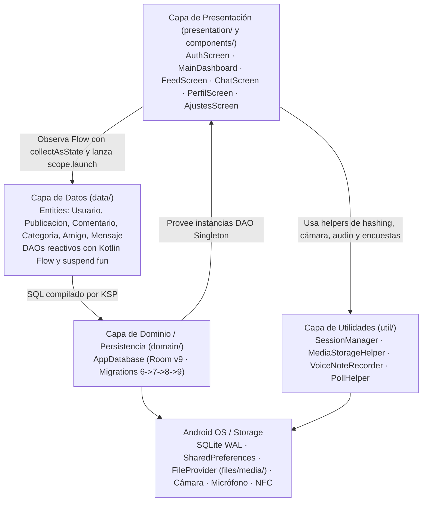
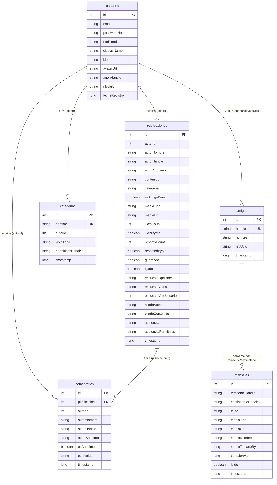
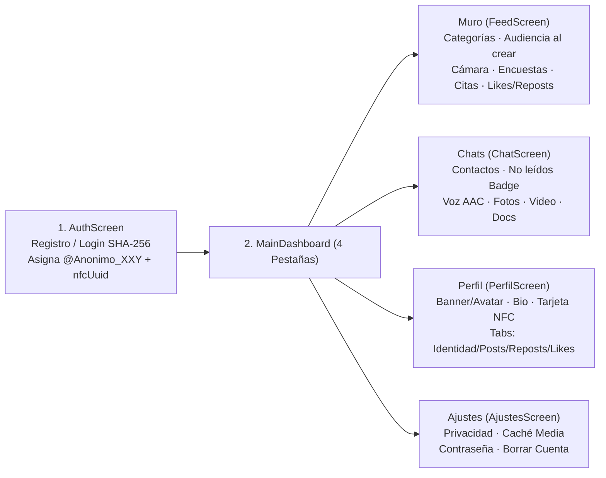
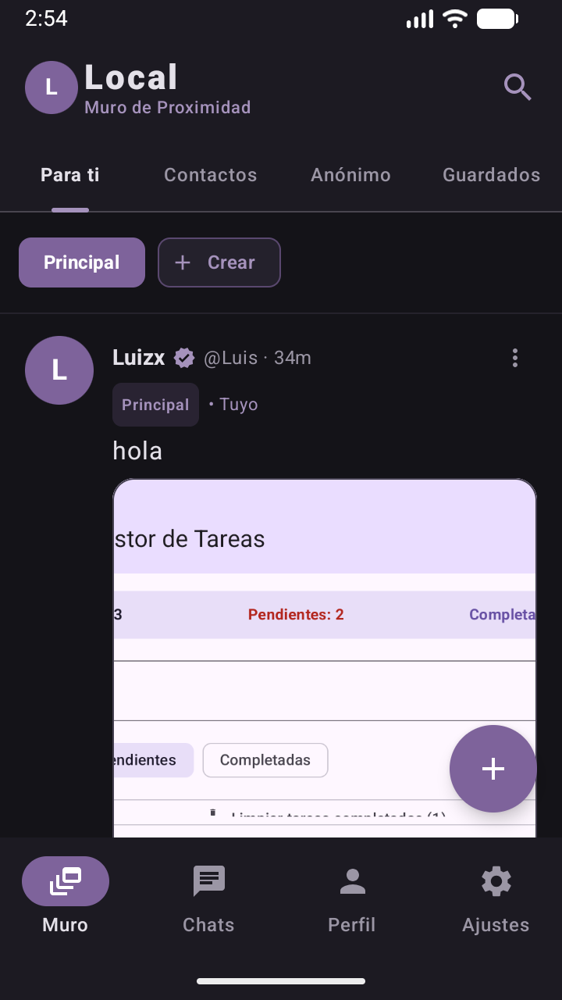
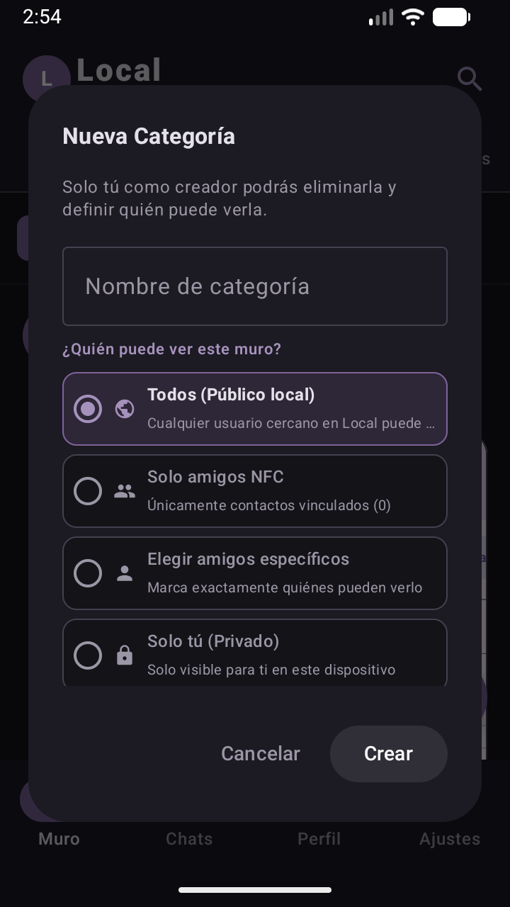

# Documento Técnico Formal — Proyecto **Local** (`RedSocialNFC`)

> **Asignatura / Evaluación:** APP Móvil JC  
> **Periodo de Exposición:** 30 de Noviembre – 6 de Diciembre (Miércoles, Jueves y Viernes)  
> **Nombre de la Aplicación:** **Local** (`com.example.redsocialnfc`)  
> **Plataforma:** Android Nativo (Kotlin 2.2.10 · Jetpack Compose · Room SQLite v9)

---

## Tabla de Contenido

1. [Presentación del Proyecto](#1-presentación-del-proyecto)
2. [Explicación y Procedimiento Técnico (Arquitectura, Código y Base de Datos)](#2-explicación-y-procedimiento-técnico)
3. [Funcionalidad Completa de la Aplicación](#3-funcionalidad-completa-de-la-aplicación)
4. [Requerimientos Funcionales y No Funcionales](#4-requerimientos-funcionales-y-no-funcionales)
5. [Evidencia de Verificación y Pruebas Unitarias](#5-evidencia-de-verificación-y-pruebas-unitarias)
6. [Preguntas del Asesor a los Alumnos (Defensa Técnica)](#6-preguntas-del-asesor-a-los-alumnos-defensa-técnica)

---

## 1. Presentación del Proyecto

### 1.1 Resumen Ejecutivo
**Local** (`RedSocialNFC`) es una aplicación móvil nativa para Android enfocada en la **interacción social de proximidad y privacidad dual**, diseñada con enfoque **offline-first** sobre almacenamiento local relacional (`Room SQLite`) y preparada estructuralmente para intercambio de identidad mediante hardware **NFC** (*Near Field Communication*).

A diferencia de las redes sociales tradicionales que centralizan datos en servidores remotos y obligan a usar una única identidad pública, **Local** implementa un modelo de **identidad de doble grado**:
- **1er Grado (Identidad Real):** Identificador público `@handle` y nombre visible editable, orientado a publicaciones abiertas y mensajería directa con contactos vinculados.
- **2do Grado (Pseudónimo Anónimo Fijo):** Identificador autogenerado al registrarse con formato `@Anonimo_XXY` (inmutable), que permite expresarse en el muro o responder comentarios protegiendo la identidad personal.

### 1.2 Planteamiento del Problema y Objetivos
**Problemática atendida:** En entornos presenciales cerrados (campus universitarios, aulas, eventos académicos), los usuarios carecen de un espacio de comunicación local que preserve sus publicaciones y archivos en el propio dispositivo, ofrezca participación anónima sin pérdida de trazabilidad local y permita decidir explícitamente qué grupo de contactos puede ver cada espacio creado.

**Objetivo General:**  
Desarrollar una aplicación Android robusta con interfaz declarativa en Jetpack Compose, persistencia relacional versionada en SQLite (Room) y control granular de privacidad por identidad y audiencia de muro.

**Objetivos Específicos:**
1. Implementar autenticación local segura con hash criptográfico `SHA-256` y gestión de sesión sincronizada.
2. Diseñar un esquema relacional normalizado en Room (`version = 9`) con migraciones no destructivas para preservar información de usuarios existentes.
3. Proveer un muro social enriquecido con categorías creadas por usuarios, selector de audiencia al crear, encuestas, citas, fijado, reacciones y captura multimedia segura con cámara, galería y video.
4. Integrar mensajería directa multimedial (texto, notas de voz AAC/MPEG-4, fotos, video y documentos) con conteo reactivo de mensajes no leídos.
5. Integrar comunicación física de proximidad mediante **NFC real** utilizando **Host-based Card Emulation (HCE)** (`HostApduService`) y **Reader Mode** (`NfcAdapter.enableReaderMode`) con protocolo ISO 7816-4.

### 1.3 Stack Tecnológico Verificado
Extraído directamente de [gradle/libs.versions.toml](../gradle/libs.versions.toml) y [app/build.gradle.kts](../app/build.gradle.kts):

| Componente | Tecnología / Librería | Versión / Configuración | Propósito |
| :--- | :--- | :--- | :--- |
| **Lenguaje** | Kotlin | `2.2.10` | Lógica reactiva, corrutinas y UI declarativa |
| **Build System** | Android Gradle Plugin (AGP) | `9.3.2` · `compileSdk = 37` | Compilación y empaquetado APK |
| **Compatibilidad** | Android SDK | `minSdk = 24` · `targetSdk = 37` | Cobertura desde Android 7.0 hasta Android moderno |
| **Interfaz (UI)** | Jetpack Compose + Material 3 | `composeBom = 2026.02.01` + `material-icons-extended` | Vistas declarativas, tema oscuro mate y animaciones |
| **Base de Datos** | AndroidX Room (`room-runtime`, `room-ktx`) + KSP | `2.8.4` | ORM sobre SQLite con `Flow` y consultas compiladas en tiempo de build |
| **Imágenes** | Coil Compose (`io.coil-kt:coil-compose`) | `2.7.0` | Carga asíncrona y recorte de avatares y fotografías locales |
| **Hardware y Media** | `FileProvider`, `ActivityResultContracts`, `MediaRecorder`, `MediaPlayer`, `VideoView` | SDK Android nativo | Cámara, micrófono AAC-MP4, galería y visor/reproductor local |
| **Pruebas** | JUnit 4 + Compose UI Test | `junit = 4.13.2` | Validación unitaria automatizada |

---

## 2. Explicación y Procedimiento Técnico

### 2.1 Arquitectura del Software por Capas
El proyecto sigue una arquitectura modular por responsabilidades bajo el paquete base `com.example.redsocialnfc`:



### 2.2 Modelo de Base de Datos Relacional (`AppDatabase`, SQLite v9)

La base de datos `red_social_nfc_db` está definida en [AppDatabase.kt](../app/src/main/java/com/example/redsocialnfc/domain/AppDatabase.kt) con **6 entidades** (`@Entity`) y **6 interfaces DAO** (`@Dao`).



#### Decisiones clave de diseño e integridad en SQLite:
1. **Índices y unicidad:**
   - [Categoria.kt](../app/src/main/java/com/example/redsocialnfc/data/Categoria.kt): `Index(value = ["nombre"], unique = true)` impide categorías duplicadas a nivel de motor SQLite.
   - [Amigo.kt](../app/src/main/java/com/example/redsocialnfc/data/Amigo.kt): `Index(value = ["handle"], unique = true)` combinado con `OnConflictStrategy.IGNORE` en [AmigoDao.kt](../app/src/main/java/com/example/redsocialnfc/data/AmigoDao.kt) previene contactos duplicados al vincular por chat o NFC.
   - [Comentario.kt](../app/src/main/java/com/example/redsocialnfc/data/Comentario.kt): `Index(value = ["publicacionId"])` acelera las consultas filtradas por publicación.
2. **Migraciones incrementales sin pérdida de datos (`v6 -> v9`):**
   Cada evolución del esquema agrega columnas con cláusulas `NOT NULL DEFAULT` que coinciden exactamente con `@ColumnInfo(defaultValue = ...)` en la entidad Kotlin:

```kotlin
// Archivo: app/src/main/java/com/example/redsocialnfc/domain/AppDatabase.kt (Líneas 47-92)
private val MIGRATION_6_7 = object : Migration(6, 7) {
    override fun migrate(db: SupportSQLiteDatabase) {
        db.execSQL(
            "CREATE TABLE IF NOT EXISTS `categorias` (`id` INTEGER PRIMARY KEY AUTOINCREMENT NOT NULL, `nombre` TEXT NOT NULL, `autorId` INTEGER NOT NULL, `timestamp` INTEGER NOT NULL)"
        )
        db.execSQL(
            "CREATE UNIQUE INDEX IF NOT EXISTS `index_categorias_nombre` ON `categorias` (`nombre`)"
        )
    }
}

private val MIGRATION_7_8 = object : Migration(7, 8) {
    override fun migrate(db: SupportSQLiteDatabase) {
        db.execSQL("ALTER TABLE `publicaciones` ADD COLUMN `fijado` INTEGER NOT NULL DEFAULT 0")
        db.execSQL("ALTER TABLE `publicaciones` ADD COLUMN `encuestaOpciones` TEXT NOT NULL DEFAULT ''")
        db.execSQL("ALTER TABLE `publicaciones` ADD COLUMN `encuestaVotos` TEXT NOT NULL DEFAULT ''")
        db.execSQL("ALTER TABLE `publicaciones` ADD COLUMN `encuestaVotoUsuario` INTEGER NOT NULL DEFAULT -1")
        db.execSQL("ALTER TABLE `publicaciones` ADD COLUMN `citadoAutor` TEXT")
        db.execSQL("ALTER TABLE `publicaciones` ADD COLUMN `citadoContenido` TEXT")
        db.execSQL("ALTER TABLE `mensajes` ADD COLUMN `leido` INTEGER NOT NULL DEFAULT 1")
    }
}

private val MIGRATION_8_9 = object : Migration(8, 9) {
    override fun migrate(db: SupportSQLiteDatabase) {
        db.execSQL("ALTER TABLE `categorias` ADD COLUMN `visibilidad` TEXT NOT NULL DEFAULT 'TODOS'")
        db.execSQL("ALTER TABLE `categorias` ADD COLUMN `permitidosHandles` TEXT NOT NULL DEFAULT ''")
        db.execSQL("ALTER TABLE `publicaciones` ADD COLUMN `audiencia` TEXT NOT NULL DEFAULT 'TODOS'")
        db.execSQL("ALTER TABLE `publicaciones` ADD COLUMN `audienciaPermitidos` TEXT NOT NULL DEFAULT ''")
    }
}
```

#### Consultas DAO más relevantes (Reactividad y Consistencia):
- **Ordenamiento prioritario de publicaciones fijadas** en [PublicacionDao.kt](../app/src/main/java/com/example/redsocialnfc/data/PublicacionDao.kt):
  ```kotlin
  @Query("SELECT * FROM publicaciones ORDER BY fijado DESC, timestamp DESC")
  fun obtenerTodas(): Flow<List<Publicacion>>

  @Query("UPDATE publicaciones SET categoria = 'Principal' WHERE categoria = :categoriaBorrada")
  suspend fun moverACategoriaPrincipal(categoriaBorrada: String)

  @Query("UPDATE publicaciones SET fijado = 0 WHERE autorId = :autorId AND id != :exceptoId")
  suspend fun desfijarOtrasDeAutor(autorId: Int, exceptoId: Int)
  ```
  *Explicación:* Al eliminar una categoría creada por el usuario, las publicaciones asociadas **no se pierden**: `moverACategoriaPrincipal()` las reasigna atómicamente al muro `"Principal"` antes de ejecutar `categoriaDao.eliminar(cat)`.
- **Conteo reactivo de mensajes no leídos** en [MensajeDao.kt](../app/src/main/java/com/example/redsocialnfc/data/MensajeDao.kt):
  ```kotlin
  @Query("""
      SELECT * FROM mensajes
      WHERE remitenteHandle = :miHandle OR destinatarioHandle = :miHandle
      ORDER BY timestamp DESC
  """)
  fun observarTodosParaUsuario(miHandle: String): Flow<List<Mensaje>>

  @Query("""
      UPDATE mensajes SET leido = 1
      WHERE remitenteHandle = :amigoHandle AND destinatarioHandle = :miHandle AND leido = 0
  """)
  suspend fun marcarComoLeidos(miHandle: String, amigoHandle: String)
  ```

---

### 2.3 Explicación de Partes Clave del Código Fuente

#### A) Autenticación Criptográfica (`SHA-256`), Identidad Anónima Fija y Validación de Sesión
En [SessionManager.kt](../app/src/main/java/com/example/redsocialnfc/util/SessionManager.kt) las contraseñas se digieren con `SHA-256` antes de guardarse en Room (`Usuario.passwordHash`):

```kotlin
// Archivo: app/src/main/java/com/example/redsocialnfc/util/SessionManager.kt (Líneas 39-53)
fun generarIdentidadAnonima(): String {
    val numero = Random.nextInt(10, 99)
    val letras = ('A'..'Z').toList()
    val letra = letras[Random.nextInt(letras.size)]
    return "@Anonimo_${numero}${letra}"
}

fun hashPassword(password: String): String {
    val bytes = MessageDigest.getInstance("SHA-256").digest(password.toByteArray())
    return bytes.joinToString("") { "%02x".format(it) }
}

fun verificarPassword(rawPassword: String, storedHash: String): Boolean {
    return hashPassword(rawPassword) == storedHash || rawPassword == storedHash
}
```

Además, al arrancar [MainActivity.kt](../app/src/main/java/com/example/redsocialnfc/MainActivity.kt) (`MainApp`), se consulta `db.usuarioDao().obtenerPorId(...)` para **evitar sesiones huérfanas**:

```kotlin
// Archivo: app/src/main/java/com/example/redsocialnfc/MainActivity.kt (Líneas 55-77)
LaunchedEffect(Unit) {
    if (sessionManager.haySesionActiva()) {
        val user = db.usuarioDao().obtenerPorId(sessionManager.getUserId())
        if (user != null) {
            sessionManager.guardarSesion(
                userId = user.id, email = user.email, realHandle = user.realHandle,
                displayName = user.displayName, anonHandle = user.anonHandle,
                bio = user.bio, avatarUri = user.avatarUri, nfcUuid = user.nfcUuid
            )
            sesionActiva = true
        } else {
            sessionManager.cerrarSesion()
            sesionActiva = false
        }
    } else {
        sesionActiva = false
    }
    validandoSesion = false
}
```

#### B) Control de Visibilidad al Crear Categorías y Publicaciones
Mediante `VisibilidadMuro` ([Categoria.kt](../app/src/main/java/com/example/redsocialnfc/data/Categoria.kt)) y `SelectorAudienciaMuro` ([AudienciaComponents.kt](../app/src/main/java/com/example/redsocialnfc/presentation/components/AudienciaComponents.kt)), el creador define quién puede ver el contenido al crear una categoría o publicación:

```kotlin
// Archivo: app/src/main/java/com/example/redsocialnfc/data/Categoria.kt (Líneas 8-38)
object VisibilidadMuro {
    const val TODOS = "TODOS"
    const val AMIGOS = "AMIGOS"
    const val SELECCIONADOS = "SELECCIONADOS"
    const val PRIVADO = "PRIVADO"

    fun parsearHandles(csv: String): Set<String> {
        if (csv.isBlank()) return emptySet()
        return csv.split(",").map { it.trim() }.filter { it.isNotEmpty() }.toSet()
    }

    fun serializarHandles(handles: Collection<String>): String {
        return handles.map { it.trim() }.filter { it.isNotEmpty() }.distinct().joinToString(",")
    }
}
```

En el filtrado reactivo de [FeedScreen.kt](../app/src/main/java/com/example/redsocialnfc/presentation/FeedScreen.kt):

```kotlin
val esMioPost = post.autorId == miUserId ||
    post.autorHandle == miHandle ||
    post.autorAnonimo == miAnonHandle
val cumpleAudiencia = if (esMioPost) {
    true
} else {
    val esAmigoNfc = amigos.any { it.handle.equals(post.autorHandle, ignoreCase = true) }
    when (post.audiencia) {
        VisibilidadMuro.PRIVADO -> false
        VisibilidadMuro.AMIGOS -> esAmigoNfc
        VisibilidadMuro.SELECCIONADOS -> {
            val permitidos = VisibilidadMuro.parsearHandles(post.audienciaPermitidos)
            esAmigoNfc && permitidos.any { it.equals(miHandle, ignoreCase = true) }
        }
        else -> true
    }
}
```

#### C) Captura Segura con Cámara (`FileProvider`) y Copia Local Aislada
[AndroidManifest.xml](../app/src/main/AndroidManifest.xml) declara `FileProvider` apuntando a [file_paths.xml](../app/src/main/res/xml/file_paths.xml), y [MediaComponents.kt](../app/src/main/java/com/example/redsocialnfc/presentation/components/MediaComponents.kt) provee `rememberCameraPhotoLauncher` para Muro, Chats y Perfil:

```kotlin
// Archivo: app/src/main/java/com/example/redsocialnfc/presentation/components/MediaComponents.kt (Líneas 526-555)
@Composable
fun rememberCameraPhotoLauncher(
    prefijo: String,
    onFotoCapturada: (MediaFileResult) -> Unit
): () -> Unit {
    val context = LocalContext.current
    val callbackActual by rememberUpdatedState(onFotoCapturada)
    var rutaPendiente by rememberSaveable { mutableStateOf<String?>(null) }

    val takePictureLauncher = rememberLauncherForActivityResult(
        contract = ActivityResultContracts.TakePicture()
    ) { success ->
        val path = rutaPendiente
        rutaPendiente = null
        if (path != null) {
            val file = File(path)
            if (success && file.exists() && file.length() > 0L) {
                callbackActual(
                    MediaFileResult(
                        localPath = file.absolutePath, fileName = file.name,
                        sizeBytes = file.length(), durationMs = 0L, mimeType = "image/jpeg"
                    )
                )
            } else {
                file.delete()
            }
        }
    }
    // Solicita Manifest.permission.CAMERA antes de launch(contentUri)
}
```

#### D) Audio AAC/MPEG-4, Encuestas y Eliminación en Cascada
- **Notas de voz (`VoiceNoteRecorder` en [AudioHelper.kt](../app/src/main/java/com/example/redsocialnfc/util/AudioHelper.kt)):** Graba `MPEG_4`/`AAC` a `96 kbps`, `44.1 kHz`, descartando toques menores a `350 ms`.
- **Encuestas ([PollHelper.kt](../app/src/main/java/com/example/redsocialnfc/util/PollHelper.kt)):** Serializa 2–4 opciones con `URLEncoder`/`URLDecoder` y soporta votar, cambiar voto y retirar voto.
- **Borrado en cascada ([AjustesScreen.kt](../app/src/main/java/com/example/redsocialnfc/presentation/AjustesScreen.kt)):** Valida contraseña SHA-256 actual y elimina comentarios, categorías, publicaciones, mensajes, amigos y usuario.

---

## 3. Funcionalidad Completa de la Aplicación



| Muro Principal Limpio | Creación de Categoría y Audiencia |
| :---: | :---: |
|  |  |

1. **Autenticación (`AuthScreen`):** Registro/inicio de sesión local con correo y `@handle` único, pseudónimo fijo `@Anonimo_XXY` y `nfcUuid`.
2. **Muro (`FeedScreen`):** Pestañas *Para ti*, *Contactos*, *Anónimo*, *Guardados*; búsqueda instantánea; categoría `Principal` + categorías del creador con selector *"¿Quién puede ver este muro?"* al crear; fotos de cámara/galería, videos, encuestas, citas, likes, reposts, fijado y respuestas.
3. **Chats (`ChatScreen`):** Bandeja inicial limpia sin contactos ficticios; badge de mensajes no leídos en vivo; texto, cámara, galería, video, notas de voz M4A y documentos.
4. **Perfil (`PerfilScreen`):** Banner, avatar editable (cámara/galería), métricas, tarjeta de identidad 1er/2do grado + UUID NFC copiable, y pestañas *Identidad*, *Posts*, *Reposts* y *Likes*.
5. **Ajustes (`AjustesScreen`):** Interruptores persistentes, cálculo y limpieza de `files/media/`, cambio de contraseña y eliminación en cascada.

---

## 4. Requerimientos Funcionales y No Funcionales

### 4.1 Requerimientos Funcionales (RF)

| ID | Nombre del Requerimiento | Descripción Funcional | Módulo / Implementación | Prioridad |
| :--- | :--- | :--- | :--- | :--- |
| **RF-01** | Registro e inicio de sesión local | Crear cuenta con correo y `@handle` único o iniciar sesión validando credenciales locales. | `AuthScreen.kt`, `UsuarioDao.kt`, `SessionManager.kt` | Alta |
| **RF-02** | Asignación de identidad dual (1er y 2do grado) | Asignar pseudónimo `@Anonimo_XXY` inalterable y `nfcUuid` por dispositivo durante el registro. | `SessionManager.kt`, `Usuario.kt` | Alta |
| **RF-03** | Validación y persistencia de sesión | Mantener la sesión activa verificando que el `userId` aún exista en SQLite antes de abrir el dashboard. | `MainActivity.kt` (`MainApp`), `SessionManager` | Alta |
| **RF-04** | Publicación con identidad seleccionable | Crear, editar y eliminar posts eligiendo identidad visible o anónima, texto (280 chars), zona, foto de cámara/galería o video. | `FeedScreen.kt` (`CrearPostTwitterSheet`), `PublicacionDao` | Alta |
| **RF-05** | Gestión de categorías por creador | Categoría base `Principal`, creación de categorías únicas y eliminación exclusiva por el creador (`autorId`), moviendo posts a `Principal`. | `FeedScreen.kt`, `Categoria.kt`, `CategoriaDao.kt` | Media |
| **RF-06** | Selector de audiencia al crear muro o post | Seleccionar al crear categoría o post quién puede verlo (`Todos`, `Solo amigos NFC`, `Elegir amigos específicos`, `Solo tú`) y filtrar el feed acorde. | `AudienciaComponents.kt`, `Categoria.kt`, `FeedScreen.kt` | Alta |
| **RF-07** | Encuestas interactivas y citas | Adjuntar encuestas de 2 a 4 opciones con porcentaje y cambio de voto, además de citar y fijar posts. | `PollHelper.kt`, `FeedScreen.kt` | Media |
| **RF-08** | Interacciones sociales y perfil | Soportar *likes*, *reposts*, *guardados* y *comentarios* (visibles o anónimos), reflejados en **Identidad**, **Posts**, **Reposts** y **Likes**. | `FeedScreen.kt`, `PerfilScreen.kt`, `ComentarioDao.kt` | Alta |
| **RF-09** | Filtrado y búsqueda en el muro | Filtrar por pestaña, categoría y búsqueda textual instantánea. | `FeedScreen.kt` (`FiltroFeed`, `listaFiltrada`) | Media |
| **RF-10** | Gestión de contactos y chats vacíos por defecto | Iniciar chats sin contactos ficticios y agregar amigos con `@handle` único. | `ChatScreen.kt`, `Amigo.kt`, `AmigoDao.kt` | Alta |
| **RF-11** | Mensajería directa multimedial | Enviar texto, fotos de cámara/galería, videos, notas de voz AAC/M4A, audio y documentos con conteo de no leídos. | `ChatScreen.kt`, `AudioHelper.kt`, `MensajeDao.kt` | Alta |
| **RF-12** | Edición de perfil y foto | Modificar nombre visible, biografía y avatar (cámara/galería), propagando cambios a publicaciones. | `PerfilScreen.kt`, `UsuarioDao`, `PublicacionDao` | Media |
| **RF-13** | Panel de ajustes y almacenamiento | Interruptores de privacidad/apariencia, cambio de contraseña, limpieza de `media/` y reinicio de chats. | `AjustesScreen.kt`, `MediaStorageHelper.kt` | Media |
| **RF-14** | Eliminación completa de cuenta | Eliminar cuenta confirmando contraseña actual, borrando en cascada comentarios, categorías, posts, mensajes, amigos y usuario. | `AjustesScreen.kt` | Alta |

### 4.2 Requerimientos No Funcionales (RNF)

| ID | Categoría | Descripción No Funcional y Criterio Verificable | Evidencia Técnica |
| :--- | :--- | :--- | :--- |
| **RNF-01** | **Seguridad Criptográfica** | Contraseñas digeridas mediante `SHA-256` hexadecimal antes de persistirse en SQLite. | `SessionManager.hashPassword()`, `AjustesScreen` |
| **RNF-02** | **Aislamiento de Archivos y Permisos** | Capturas y adjuntos guardados en `context.filesDir/media/` compartidos vía `FileProvider`, solicitando `CAMERA` y `RECORD_AUDIO` en runtime. | `AndroidManifest.xml`, `file_paths.xml`, `MediaComponents.kt` |
| **RNF-03** | **Persistencia Offline-First e Integridad ACID** | Operación local sin nube con Room SQLite v9 WAL, migraciones no destructivas (`6→7→8→9`) e índices `UNIQUE`. | `AppDatabase.kt`, `Categoria.kt`, `Amigo.kt` |
| **RNF-04** | **Rendimiento y Reactividad** | Operaciones E/S en `Dispatchers.IO`, UI reactiva con `Flow` + `collectAsState` y `LazyColumn`/`LazyRow`. | `MediaStorageHelper.kt`, DAOs con `Flow` |
| **RNF-05** | **Usabilidad y Accesibilidad Visual** | Paleta oscura mate (`#141318`, `#1C1A22`, `#7E639B`, `#E4E1E9`), `imePadding` / scroll en diálogos ante teclado virtual y 4 pestañas principales. | `Color.kt`, `MainDashboard.kt`, `FeedScreen.kt` |
| **RNF-06** | **Compatibilidad y Portabilidad** | Soporte desde `minSdk = 24` (Android 7.0) hasta `targetSdk = 37`, con `nfc` y `camera` declarados `required="false"`. | `app/build.gradle.kts`, `AndroidManifest.xml` |
| **RNF-07** | **Mantenibilidad y Modularidad** | Separación por capas (`data`, `domain`, `presentation`, `components`, `util`, `ui/theme`) con componentes reutilizables. | Estructura `app/src/main/java/...` |
| **RNF-08** | **Confiabilidad y Verificación** | Pruebas unitarias JUnit 4 cubriendo hashing, pseudónimo, formateo media, encuestas, visibilidad de muro y protocolo NFC APDU/JSON (`7/7` OK). | [MediaAndSessionTest.kt](../app/src/test/java/com/example/redsocialnfc/MediaAndSessionTest.kt) |
| **RNF-09** | **Integración Hardware (NFC HCE + ReaderMode)** | Servicio `NfcHandshakeService` (`HostApduService`), AID `F0010203040506`, lectura `IsoDep`/`Ndef`, vibración háptica y simulador para emuladores. | `NfcHandshakeService.kt`, `NfcHelper.kt`, `apduservice.xml` |

---

## 5. Evidencia de Verificación y Pruebas Unitarias

- **Compilación y Build:** `gradlew.bat testDebugUnitTest assembleDebug --no-daemon` → **`BUILD SUCCESSFUL`**.
- **Suite Unitaria ([MediaAndSessionTest.kt](../app/src/test/java/com/example/redsocialnfc/MediaAndSessionTest.kt)):** **7 de 7 pruebas aprobadas** (`skipped="0"`, `failures="0"`, `errors="0"`), incluyendo validación de comandos APDU ISO 7816-4 y serialización JSON NFC.
- **Verificación en Emulador (`emulator-5554`):** Migración verificada a `PRAGMA user_version = 9` conservando usuario y publicaciones previas.

---

## 6. Preguntas del Asesor a los Alumnos (Defensa Técnica)

A continuación se documentan **3 preguntas clave** que el docente/asesor puede realizar durante la exposición, junto con la respuesta técnica respaldada directamente por el código y la base de datos:

### Pregunta 1: *¿Por qué utilizaron Room SQLite local con migraciones en lugar de Firebase o un servidor REST tradicional, y cómo garantizan que no se pierdan los datos al actualizar la app?*
**Respuesta:**  
**Local** (`RedSocialNFC`) está diseñada bajo un enfoque **offline-first** para entornos presenciales (campus, aulas o eventos sin dependencia obligatoria de internet o servidores externos). Usar **Room SQLite (`version = 9`)** permite consultas reactivas en tiempo real mediante `Flow` y verificación de sintaxis SQL en tiempo de compilación con **KSP**.  
Para evitar la pérdida de datos al evolucionar el esquema (al agregar categorías, comentarios, audiencias y mensajes multimedia), implementamos **migraciones explícitas no destructivas** (`MIGRATION_6_7`, `MIGRATION_7_8`, `MIGRATION_8_9` en `AppDatabase.kt`) con sentencias `ALTER TABLE` y `CREATE TABLE IF NOT EXISTS`, garantizando integridad ACID sin borrar usuarios ni publicaciones previas.

### Pregunta 2: *¿Cómo implementaron el intercambio de contactos por NFC y qué pasa si el dispositivo o emulador no tiene chip NFC o usa Android moderno?*
**Respuesta:**  
En lugar de usar *Android Beam* (obsoleto desde Android 10 y eliminado en Android 14), implementamos el estándar moderno **HCE (Host-based Card Emulation)** con protocolo **ISO 7816-4**:
1. El teléfono emisor ejecuta `NfcHandshakeService` (subclase de `HostApduService`) registrado en `AndroidManifest.xml` con el descriptor `apduservice.xml` y el AID propietario `F0010203040506`.
2. El teléfono receptor activa `NfcAdapter.enableReaderMode` desde `NfcHelper.kt`, envía el comando `SELECT AID` vía `IsoDep` (con respaldo para etiquetas físicas `Ndef`), recibe el JSON de identidad firmado con Status Word `90 00`, vibra y guarda automáticamente al contacto en la tabla `amigos` de Room.
3. Declaramos `android.hardware.nfc` con `required="false"` e incluimos una pestaña de **Simulación / Manual** dentro de `DialogNfcHandshake.kt` que ejecuta exactamente el mismo serializador/deserializador `NfcProtocol`, permitiendo demostrar la funcionalidad tanto en dos teléfonos reales como en el emulador.

### Pregunta 3: *¿Cómo controlan la privacidad de la identidad dual y quién puede ver las publicaciones sin afectar el rendimiento?*
**Respuesta:**  
Cada usuario posee una identidad pública (`realHandle`, editable en perfil) y un pseudónimo fijo autogenerado (`@Anonimo_XXY`), además de contraseñas almacenadas únicamente como hash criptográfico **`SHA-256`** (`SessionManager.hashPassword`).  
Al crear una publicación o categoría, el usuario selecciona la audiencia (`TODOS`, `AMIGOS`, `SELECCIONADOS`, `PRIVADO`). El muro (`FeedScreen.kt`) evalúa reactivamente en memoria con `remember` la lista de amigos vinculados en SQLite (`AmigoDao`) y los `audienciaPermitidos`, mostrando únicamente lo autorizado sin bloquear el hilo principal (E/S en `Dispatchers.IO`).
